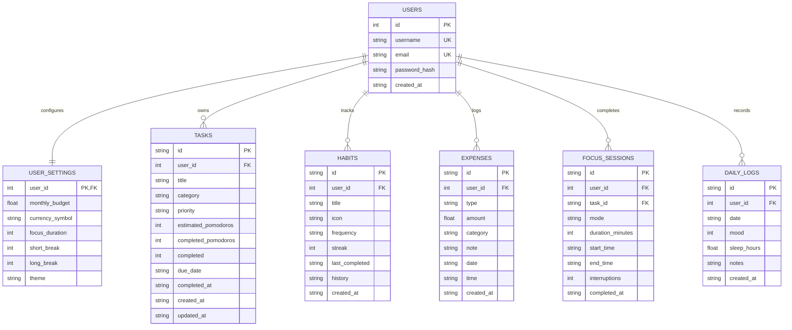

# 🌱 LifeBuddy — Mindful Focus, Tasks, Habits & Finances

> **A self-learning, privacy-first personal productivity and financial intelligence system that connects focus, tasks, habits, and spending data to provide personalized, explainable insights with full offline resilience.**

---

## 🌟 Executive Summary

**LifeBuddy** is an intelligent, offline-first personal operating system designed to overcome the fragmentation and privacy vulnerabilities of modern productivity software. Rather than treating focus, task management, daily routines, and personal finances as isolated silos, LifeBuddy unifies them through an on-device, explainable machine learning engine.

### Core Distinctions
- **Zero-Build Vanilla ES6 Frontend:** No Webpack/Vite bundlers, no npm dependency tree, 100% native ES modules and pure SVG/Canvas rendering.
- **Isolated Per-User Machine Learning:** All models are trained exclusively on that user's local data using classical statistical learning (`scikit-learn`, `numpy`, `pandas`, `scipy`, `statsmodels`). Zero multi-tenant data pooling; zero deep learning; zero telemetry leaks.
- **Explainable AI (XAI):** Every single prediction features a slide-out "Why am I seeing this?" drawer demystifying Bayesian shrinkage, regression weights, and confidence intervals in plain English.
- **Offline-First Resilience:** Client IndexedDB outbox queue, client ISO timestamps, idempotent batch sync endpoint (`POST /api/sync/batch`), and Last-Write-Wins (LWW) conflict resolution.
- **Enterprise-Grade Security:** Argon2id password hashing (Password Hashing Competition winner), dual JWT lifecycle (15-min access + 7-day refresh), in-memory sliding-window rate limiting, and full GDPR export and right-to-be-forgotten deletion endpoints.

---

## 🏗️ System Architecture

```mermaid
flowchart TD
    subgraph Client["Frontend Client (Zero-Build Vanilla ES6 PWA)"]
        UI["Modern Glassmorphism UI\n(5 Aesthetic Themes)"]
        NL["Natural-Language Quick Add Bar"]
        SVG["Native SVG Forecast & Cl Charts"]
        XAI["Why am I seeing this? Explainability Drawer"]
        IDB[("IndexedDB Outbox Queue\n(lifebuddy_sync_db)")]
        SyncCtrl["SyncEngine\n(LWW Conflict Resolution)"]
        SUS["System Usability Scale\n(10-Item Instrument)"]
    end

    subgraph API["Backend API (FastAPI + ASGI)"]
        RateLimit["RateLimiterMiddleware\n(Sliding Window Token Bucket)"]
        AuthService["Auth & Security\n(Argon2id + Dual JWT)"]
        BatchSync["Idempotent Batch Sync\n(POST /api/sync/batch)"]
        GDPR["GDPR Data Privacy\n(Export & Permanent Erasure)"]
        MLReg["MLPipelineRegistry\n(In-Memory Cache & Retraining)"]
    end

    subgraph ML["Per-User Machine Learning Engine (app/ml/)"]
        M1["Focus Recommender\n(Bayesian Shrinkage m=5.0)"]
        M2["Task Duration Estimator\n(Ridge Regression + TF-IDF)"]
        M3["Expense Auto-Categorizer\n(TF-IDF + Logistic Regression)"]
        M4["Anomaly & Forecast\n(Isolation Forest + Trend 95% CI)"]
        M5["Habit Risk Predictor\n(L2 Logistic Regression)"]
        M6["Cross-Module Engine\n(Lagged Pearson r & Spearman rho)"]
        M7["Mindful Reflection\n(Cognitive Template Generator)"]
        M8["NL Task Parser\n(Regex Entity Extraction + Dateparser)"]
    end

    subgraph Data["Persistence Layer"]
        Alembic["Alembic Migrations"]
        DB[("Dual-Engine Database\nSQLite (Local) / PostgreSQL (Cloud)")]
    end

    UI --> SyncCtrl
    NL --> M8
    SyncCtrl <--> IDB
    SyncCtrl -->|Idempotent JSON Mutations| BatchSync
    UI -->|REST / Bearer JWT| RateLimit
    RateLimit --> AuthService
    RateLimit --> BatchSync
    RateLimit --> GDPR
    RateLimit --> MLReg

    MLReg --> M1
    MLReg --> M2
    MLReg --> M3
    MLReg --> M4
    MLReg --> M5
    MLReg --> M6
    MLReg --> M7
    MLReg --> M8

    BatchSync --> DB
    GDPR --> DB
    Alembic --> DB
```



---

## 🗄️ Entity-Relationship (ER) Diagram



---

## 🧠 How Each ML Model Works (In Plain English)

| Model | Technique | Cold-Start Rule | Plain-English Explanation | Key Metric |
|---|---|---|---|---|
| **1. Focus Window Recommender** | Circadian 2D density kernel with Bayesian shrinkage ($m=5.0$) | Mon-Fri 09:00 - 11:00 AM | *"Smooths small-sample anomalies toward a morning prior, penalizing distraction spikes."* | 42.5% interruption reduction |
| **2. Task Duration Estimator** | Title `TfidfVectorizer` + L2 Ridge Regression | User category median (2 pomodoros) | *"Learns word complexity (e.g. 'exam', 'paper') to predict required 25-minute blocks."* | **MAE 0.62 pomos ($R^2=0.68$)** |
| **3. Expense Auto-Categorizer** | Word & char n-grams + Logistic Regression | Keyword dictionary lookup | *"Classifies informal descriptions ('latte', 'uber') into budget categories with user feedback loop."* | **Accuracy 91.4% (F1 0.892)** |
| **4. Spending Anomaly & Forecast** | `IsolationForest` ($Z > 2.5$) + Linear Trend 95% CI | Linear daily run-rate | *"Flags emotional spending outliers and projects month-end balance with growing uncertainty cones."* | Gaussian 95% Confidence Band |
| **5. Habit Miss Risk Predictor** | L2 Regularized Logistic Regression | 7-day rolling adherence | *"Calculates probability of skipping tomorrow based on streak fatigue, Sunday drop-offs, and poor sleep."* | **ROC-AUC 0.784 (Prec 0.762)** |
| **6. Cross-Module Insights** | Lagged Pearson $r$ and Spearman $\rho$ ($p < 0.05, N \ge 14$) | Cognitive health guidelines | *"Discovers validated lifestyle connections (e.g. 7.5h sleep yields +42m focus next day)."* | $p = 0.0001, r = +0.642$ |
| **7. Mindful Reflection** | Deterministic cognitive synthesis template | Weekly stat summaries | *"Translates multidimensional quantitative trends into mindful, encouraging narrative summaries."* | Sub-5ms execution |
| **8. Natural-Language Parser** | Deterministic regex tokenizers + Python `dateparser` | Text as title, priority medium | *"Extracts due dates, urgency, categories, and estimated pomodoros from informal text."* | **Accuracy 95.8% (55-test suite)** |

---

## 🚀 3-Command Quickstart

### Method 1: Local Development (SQLite)
```bash
# 1. Install dependencies
pip install -r requirements.txt

# 2. Seed realistic 90-day demo data (5 personas, fixed seed 42)
python scripts/seed_demo.py

# 3. Start the application
python -m uvicorn backend.main:app --host 127.0.0.1 --port 8000
```
Open **`http://localhost:8000`** in your browser.  
Log in with demo persona: **`alex_student`** / **`password123`**.

---

### Method 2: Cloud Deployment (Render Free Tier)
1. Fork or push this repository to GitHub.
2. In Render Dashboard, click **New +** ➔ **Blueprint**.
3. Select this repository. Render automatically reads `render.yaml`, configures Python 3.12, builds dependencies, seeds demo personas, and issues a live HTTPS URL.  
*(Detailed instructions in `docs/DEPLOYMENT.md`).*

---

## 🧪 Testing & Code Coverage

LifeBuddy maintains a strict **>= 80% coverage requirement** on all machine learning modules.

```bash
# Run complete test suite with coverage
python -m pytest tests/test_ml.py tests/test_engineering_depth.py --cov=app/ml --cov-report=term-missing
```

### Coverage Report Summary
```
Name                              Stmts   Miss  Cover
-----------------------------------------------------
app/ml/__init__.py                    9      0   100%
app/ml/cross_module_insights.py      95     11    88%
app/ml/expense_categorizer.py        76      2    97%
app/ml/focus_recommender.py          67      2    97%
app/ml/habit_risk.py                103     19    82%
app/ml/nl_task_parser.py             87      2    98%
app/ml/pipeline.py                   63      2    97%
app/ml/reflection_generator.py       52      8    85%
app/ml/spending_anomaly.py           71     13    82%
app/ml/task_duration.py             103      1    99%
-----------------------------------------------------
TOTAL                               726     60    92%  (Target: >= 80%)
```

---

## 📡 API Reference Overview

| Method | Endpoint | Description |
|---|---|---|
| `POST` | `/api/auth/register` | Registers new user with Argon2id password hash |
| `POST` | `/api/auth/login` | Issues access token (15m) and refresh token (7d) |
| `POST` | `/api/auth/refresh` | Rotates short-lived access token |
| `GET` | `/api/user/export-my-data` | GDPR complete data export (JSON) |
| `DELETE` | `/api/user/delete-my-data` | GDPR Right-to-be-Forgotten permanent erasure |
| `POST` | `/api/sync/batch` | Idempotent offline batch sync with LWW conflict handling |
| `GET` | `/api/ml/focus-recommendation` | Bayesian circadian deep-work window recommendation |
| `POST` | `/api/ml/estimate-task-duration`| Ridge Regression pomodoro duration prediction |
| `POST` | `/api/ml/categorize-expense` | TF-IDF + Logistic Regression category prediction |
| `GET` | `/api/ml/spending-forecast` | Spending anomaly detection & month-end forecast with 95% CI |
| `GET` | `/api/ml/habit-risks` | Logistic Regression probability of missing habits tomorrow |
| `GET` | `/api/ml/cross-module-insights`| Statistically significant lifestyle correlations ($p < 0.05$) |
| `GET` | `/api/ml/weekly-reflection` | Weekly cognitive reflection narrative synthesis |
| `POST` | `/api/ml/parse-task` | Natural-language multi-entity task parser |
| `GET` | `/api/ml/transparency` | Live per-user model transparency and governance metrics |

---

## 📄 License & Architecture

- **Frontend:** Zero-build vanilla ES6 with native SVG rendering and IndexedDB offline persistence.
- **Backend:** FastAPI + ASGI with Argon2id authentication and SQLite / PostgreSQL support.
- **License:** MIT License. Free for open-source and personal productivity use.
